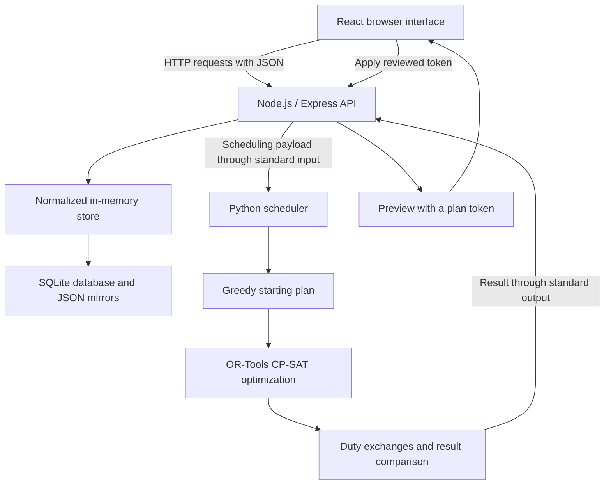

# Technology and scheduling guide

This guide explains the current implementation of UNI Exam Invigilation Scheduler. It covers the application architecture, how assignments are chosen, what the priorities mean, and how to interpret scheduling results.

## 1. What the application does

The application assigns teaching assistants (TAs) and Doctors to exam sessions and on-call reserve periods. It considers staffing requirements, staff policies, availability, existing duties, and workload balance.

The scheduler is a constraint optimization system. It uses explicit rules and mathematical search, rather than a language model, to choose assignments.

It has two kinds of scheduling decisions:

- **Hard constraints:** conditions an assignment must satisfy under the selected scheduling mode.
- **Soft preferences:** things the scheduler tries to improve after protecting coverage and workload balance.

For example, assigning someone to overlapping duties is prohibited. Giving someone consecutive working days is a preference: it can lose to a higher priority.

## 2. Technology stack

| Technology | Its job in this application |
| --- | --- |
| React 18 | Builds the browser interface, forms, tables, previews, and dashboards. |
| React Router 6 | Provides navigation between pages such as Scheduling, Scheduling Rules, Staff Schedule, and Conflict Dashboard. |
| Vite 5 | Runs the frontend development server and builds the production frontend. |
| Node.js | Runs the backend and starts the Python scheduling process. |
| Express 4 | Provides the HTTP API used by the frontend and serves the built frontend. |
| Python 3 | Normalizes scheduling inputs, builds the optimization model, and returns a proposed schedule. |
| Google OR-Tools CP-SAT | Searches for assignments that satisfy constraints and improve the scheduling objectives. |
| SQLite through `sql.js` | Stores application data locally. `sql.js` runs SQLite through WebAssembly and the backend saves the database to a file. |
| JSON | Carries data between components and provides readable storage mirrors and backup/export data. |
| SheetJS `xlsx` | Reads and writes Excel workbooks for imports, previews, assignments, and reports. |

The version numbers above are the major versions declared in the package manifests, not a guarantee of a particular installed patch version.

### How the parts communicate



If OR-Tools cannot be imported, the Python scheduler can return a greedy fallback plan. Python itself must still be available for this scheduling path.

## 3. Data and storage

The main data includes:

- Exam sessions: date, start/end time, room, courses, and required TAs/Doctors.
- Staff: identity, role, maximum hours, and related information.
- Staff hour policies: workload settings, exclusions, consecutive preferences, and engagement override permission.
- Engagements: periods when a person is unavailable.
- Assignments: exam, on-call, control, and super-invigilator duties.
- Scheduling configuration: preference order, scoring mode, point weights, and daily soft target.
- On-call configuration: reserve staffing requirements and staff exclusions.

The backend normally reads a cloned snapshot of its normalized in-memory store. It does not query SQLite separately for every scheduling decision.

Persistent files are:

| File | Purpose |
| --- | --- |
| `server/data/scheduler.sqlite` | Durable SQLite database. |
| `server/data/store.json` | Readable JSON mirror. |
| `server/data/store.last-good.json` | Backup JSON mirror. |

At startup, the backend compares reconstructed SQLite data with available JSON data and selects a source using its recovery and data-richness checks. A nonempty SQLite source wins when its score is at least the JSON source's score. Selected JSON data can be promoted into SQLite; selected SQLite data rebuilds the JSON mirrors.

Writes are queued. A successful write synchronizes SQLite, writes the JSON mirrors, updates the in-memory state, and increments the store version. That version also invalidates cached derived views and older scheduling previews.

The current startup source can be inspected through `GET /api/system/storage-status`.

## 4. What happens when you request a preview

1. **Take a snapshot.** The API reads sessions, staff, policies, engagements, and existing assignments.
2. **Apply the selected scope and preservation mode.** It decides which roles and duty types may change and which assignments must remain fixed.
3. **Build the Python payload.** Dates, times, staffing requirements, fixed duties, hour limits, and preferences are converted into solver inputs.
4. **Generate on-call requirements when needed.** Combined scheduling represents reserve periods as additional duties in the same optimization problem.
5. **Validate the inputs.** Python checks identifiers, roles, times, policies, and fixed assignments. Conflicting fixed assignments can cause validation to fail.
6. **Build a greedy plan.** A quick constructive algorithm provides a feasible starting point and a fallback candidate.
7. **Run CP-SAT.** The optimizer improves coverage, workload distribution, and preferences in stages.
8. **Try duty exchanges.** Local exchanges try to improve preferences while preserving each person's total hours and session/on-call hours.
9. **Compare results.** The scheduler compares the CP-SAT and fallback candidates using coverage and quality metrics; it does not automatically choose CP-SAT just because it ran.
10. **Return a reviewable preview.** The API returns assignments, shortages, workload figures, override reasons, diagnostics, and a temporary plan token.

The greedy candidate can also receive an exchange pass before being used as the CP-SAT starting plan.

**A preview does not save assignments.**

## 5. Preservation modes and scheduling scopes

| Mode | Meaning |
| --- | --- |
| `preserve_all` | Keep existing exam assignments and fill remaining requirements. |
| `preserve_manual_only` | Preserve assignments classified as manual/locked by the mode's source and lock rules; rebuild replaceable assignments. This requires usable assignment metadata. |
| `rebalance_all` | Allow existing exam assignments in the selected role scope to be rebuilt. |

Role scope can include both roles, TAs only, or Doctors only. Assignments belonging to the other role are preserved.

Combined scheduling plans exam and on-call assignments together. On-call-only planning keeps exam assignments fixed. In session-only planning, existing reserve, control, and super duties still consume hours and block overlapping assignments.

Preservation is determined by the chosen mode. A lock should not be assumed to survive a mode that deliberately rebuilds all selected assignments.

## 6. Hard rules and staff hour policies

In normal strict scheduling, the model protects:

- Role matching: a TA slot requires a TA, and a Doctor slot requires a Doctor.
- Duty conflicts: a person cannot receive overlapping duties.
- Fixed busy periods from control, super, and other preserved duties.
- Maximum hours, where a positive maximum is configured.
- Custom staff hour caps and scheduling exclusions.
- On-call exclusions for reserve assignments.
- Blocked engagements when the person's policy does not permit an override.
- Assignments preserved by the selected scope and mode.

### How hour policies work

The scheduler calculates an approximate required-hours average separately for each role:

```text
Role average = required duty minutes for the role / non-excluded staff in that role
```

Required minutes depend on the planning scope and include relevant additional duty requirements. The Python calculation rounds the role average to whole minutes.

| Policy | Interpretation |
| --- | --- |
| Default | Use the role average as a balancing target. The average is not a hard maximum. |
| Exact | Use the entered hours as a hard cap. It does not guarantee exactly that many assigned hours. |
| Add | Use role average plus the entered hours as a hard cap. |
| Reduce | Use role average minus the entered hours, floored at zero, as a hard cap. |
| Exclude | Do not create automatic assignments for that person in strict mode. |

If both a custom cap and a positive maximum are present, the smaller limit applies. Existing other duties consume the person's available hours.

### Engagement override permission

`Allow engagement override` defaults to enabled through the application policy path. It allows actual staff engagements to be crossed when the scheduling objectives favour doing so.

It does not allow overlapping assignments or overriding generated busy periods from other duties. Disabling the checkbox makes actual engagements strict for that person, including in shortage-filling mode.

The report records the affected duty, overlap, and scheduling reason. The original engagement record is retained.

### Separate shortage-filling exceptions

The optional `cover_shortage` mode also has a legacy exception path. In the current implementation it applies only to selected-role staff who have neither consecutive preference enabled and whose engagement override permission is off.

For that eligible subset, custom policy caps and exclusions can be relaxed. Positive explicit maximum hours and duty conflicts remain protected, and blocked engagements still respect the staff checkbox. Proposed policy exceptions appear in the preview's override report.

This exception path is separate from ordinary engagement override permission. Strict mode is the default.

## 7. How CP-SAT chooses assignments

CP-SAT combines constraint programming with techniques from satisfiability solving. Here it searches over Boolean assignment choices and integer quantities such as assigned minutes and remaining shortages.

For each eligible staff/duty combination, the model creates a variable:

```text
x[staff, duty, role] = 1 if assigned; otherwise 0
```

For each required role in a duty:

```text
New assignments + shortage = required staff - preserved assignments
```

Other constraints prevent time overlaps and exceeding hour caps. Ineligible combinations are filtered before or constrained during model construction.

### Protected optimization stages

The main order is:

1. Fill exam duties first, then on-call duties.
2. Minimize applicable legacy exceptions when that mode is enabled.
3. Improve total workload balance within each role and against policy targets.
4. Balance session and on-call hours separately among eligible default-policy staff.
5. Improve on-call hour distribution.
6. Optimize the configurable preferences.

Exam coverage has a deliberate mathematical advantage. If `R` is the number of required on-call slots, the coverage objective is:

```text
Coverage penalty = (R + 1) * unfilled exam slots + unfilled on-call slots
```

So removing one exam shortage is more valuable than removing all on-call shortages combined.

After a stage finds a feasible result, later stages must retain the achieved value or stay within its accepted bound. This protects earlier priorities. Under a time limit, the achieved value may still be worse than the mathematical optimum.

Workload balance considers target deviations and differences within each role. Equal hours are not guaranteed when availability, caps, fixed duties, and duty durations differ.

## 8. Editable priorities and weighted points

The Scheduling Rules page offers two methods for the remaining preferences. Neither method moves these preferences ahead of coverage or protected workload objectives.

### Method A: priority order

Use **Up** and **Down** to rank preferences. The first preference wins against lower preferences when they conflict.

The default order is:

1. Minimize engagement overrides.
2. Prefer consecutive working days.
3. Prefer consecutive duties within a day.
4. Minimize duties above the daily soft target.

With that order, the scheduler may retain a calendar gap to avoid increasing engagement overlap. To make consecutive days more important than engagement minimization, move consecutive days above it and save before generating a new preview.

### Method B: weighted points

Weighted mode minimizes a combined preference penalty:

```text
Points = engagement weight * engagement overlap hours
       + day weight * calendar gap days
       + duty weight * idle hours within working days
       + daily weight * duties above the daily soft target
```

| Preference | Default points | Unit |
| --- | ---: | --- |
| Engagement overrides | 100 | Per overlap hour |
| Consecutive working days | 50 | Per calendar gap day |
| Consecutive duties | 10 | Per idle hour |
| Daily soft target | 1 | Per excess duty |

Example: one engagement-overlap hour costs 100 points, while one calendar gap day costs 50. If all protected objectives and other penalties are equal, keeping the gap is cheaper.

Weights are whole numbers from 0 to 1,000, with at least one positive weight. Zero removes that preference from the combined score, but the Up/Down order still breaks equal-score ties. It does not completely disable the preference.

The model uses integer units internally; engagement and idle minutes are converted consistently to the hour-based points shown above.

## 9. Consecutive days and consecutive duties

These are independent staff checkboxes.

| Preference | What is measured | Example |
| --- | --- | --- |
| Consecutive days | Calendar days off between the first and last working date. | Work on November 6 and 8 creates one gap day: November 7. |
| Consecutive duties | Idle minutes between the first and last duty within each working day, excluding time spent working. | Duties from 09:00-10:00 and 12:00-13:00 create 120 idle minutes. |

Weekends count as calendar gap days. Exam, on-call, control, and super duties contribute to the continuity calculation when included as assignments or fixed duties in the payload.

Continuity penalties apply only for the preferences enabled on that staff member. Enabling either checkbox expresses a preference, not a guarantee.

The final exchange pass swaps unlocked duties between people of the same role. Exchanges use the same duty type and duration, preserving every person's total hours and separate session/on-call hours. Other policies and conflicts still apply. The pass accepts improvements according to the saved ranked order or weighted score.

It is bounded by five seconds and up to 40 accepted exchanges per pass. It cannot explore every possible rearrangement. For example, some improvements require several people to exchange duties together, or duties of different lengths.

## 10. On-call staffing rules

On-call periods are grouped by **exact date, start time, and end time**. Rooms in each group are counted uniquely. Overlapping groups with different start/end times remain distinct reserve periods.

Two requirement modes are available:

- **Fixed per period:** request a configured number of TAs and Doctors for each period.
- **From active rooms:** calculate each role's requirement from room thresholds and staff-per-threshold settings.

For a group meeting the room threshold:

```text
Required reserve staff = ceil(active rooms / rooms per step) * staff per step
```

Below the threshold, the setting chooses either zero or one configured staff step. A group with no active rooms has no room-based requirement.

Example: with 7 active rooms, 3 rooms per step, and 1 TA per step, the requirement is `ceil(7 / 3) = 3 TAs`.

On-call exclusions affect reserve assignments, not exam eligibility. Consecutive preferences do not create extra reserve requirements just to fill idle time.

## 11. Preview, saving, and stale-plan protection

The API stores the proposed assignments temporarily in backend memory and returns a unique token. Applying that token saves the reviewed plan; it does not rerun the optimizer.

A plan becomes unusable when:

- Its ten-minute lifetime expires.
- A data write changes the store version, including a policy or scheduling configuration change.
- The backend restarts and loses its in-memory plans.
- The plan is already applied and its token removed.

If data changes while a preview is being calculated, version checks also prevent treating the result as a current plan.

For combined scheduling, exam and on-call assignments are saved together. This avoids saving one part of a plan while silently rebuilding the other part.

Important API routes:

| Route | Purpose |
| --- | --- |
| `GET /api/scheduling/config` | Read priorities, scoring mode, weights, and daily target. |
| `PATCH /api/scheduling/config` | Save scheduling configuration. |
| `GET /api/on-call` | Read on-call requirements, assignments, and configuration. |
| `PATCH /api/on-call/config` | Save on-call staffing rules and exclusions. |
| `POST /api/scheduling/combined/preview` | Generate a combined or on-call-scope preview. |
| `POST /api/scheduling/combined/apply` | Apply an exact combined plan token. |
| `POST /api/scheduling/auto-schedule-preview` | Generate a session scheduling preview. |
| `POST /api/scheduling/auto-schedule` | Apply a session plan token. |

## 12. Why gaps or imbalance can remain

Common reasons include:

- Too few eligible people of the required role at the same time.
- Staff already assigned to overlapping duties.
- Custom caps, maximum hours, or exclusions removing otherwise suitable candidates.
- Engagements blocking people whose override permission is off.
- Preserved assignments restricting what can be moved.
- Unequal duty durations preventing an exact split of hours.
- Higher priorities winning against consecutive preferences.
- The optimizer or exchange pass stopping before finding a better arrangement.

The API normally requests a 60-second CP-SAT budget. Validation, greedy construction, exchange passes, process startup, and result conversion add time outside that budget, so the total request can take longer than 60 seconds.

Read optimization stage statuses carefully:

| Status | Interpretation |
| --- | --- |
| `OPTIMAL` | That stage proved its best value under the model and bounds already in place. |
| `FEASIBLE` | A valid solution was found, but the stage did not prove optimality. |
| `UNKNOWN` | The stage did not return a usable feasible/optimal result in its search; an earlier feasible plan can be retained. |
| `SKIPPED_TIME_LIMIT` | No time remained for that stage. |
| `INFEASIBLE` | The model being solved has no feasible solution. |

Shortage variables normally let the model return a partial schedule rather than fail because staffing demand is too high. Invalid or contradictory fixed assignments can still prevent a valid run.

No directly available candidate for a gap means it cannot be filled by simply adding someone to that allocation. It does not prove that moving other duties could never fill it.

## 13. Conflict dashboard and reports

The Conflict Dashboard examines **saved assignments**, not an unsaved scheduling preview.

It brings together:

- Overlapping duties, duplicate assignments, and maximum-hour issues.
- Custom policy hour-cap issues.
- Engagement overlaps, separating permitted overrides from currently blocked engagements.
- Unfilled exam and on-call duties, counted separately by role.
- Total, session, and on-call hour spreads among eligible default-policy staff within each role.

For engagement reporting, each affected duty appears once in the dashboard even when it overlaps several engagement records. Overlapping engagement minutes are counted as a union so the same minute is not counted twice.

The detailed engagement report includes reasons and affected people. A permission label reflects the person's current policy; it is not proof of what that checkbox was set to when an old assignment was created.

The dashboard is an audit and navigation tool. It does not run a separate minimum-conflict optimization or prove a mathematical minimum. An empty schedule can have zero conflicts and many uncovered duties, so coverage must be reviewed alongside conflict counts.

## 14. Where the implementation lives

| File | Responsibility |
| --- | --- |
| [client/src/pages/SchedulingPage.jsx](client/src/pages/SchedulingPage.jsx) | Scheduling controls, preview review, diagnostics, exports, and apply actions. |
| [client/src/pages/SchedulingRulesPage.jsx](client/src/pages/SchedulingRulesPage.jsx) | Dedicated rules page. |
| [client/src/components/SchedulingPriorities.jsx](client/src/components/SchedulingPriorities.jsx) | Up/Down priorities, scoring mode, weights, and daily target. |
| [client/src/components/OnCallRules.jsx](client/src/components/OnCallRules.jsx) | Reserve requirements and searchable exclusions. |
| [client/src/pages/ConflictDashboardPage.jsx](client/src/pages/ConflictDashboardPage.jsx) | Saved-schedule audit interface. |
| [client/src/conflictDashboard.mjs](client/src/conflictDashboard.mjs) | Conflict classification, deduplication, gaps, and workload spreads. |
| [client/src/api.js](client/src/api.js) | Frontend API calls and caching. |
| [server/index.js](server/index.js) | API routes, payload building, Python execution, preview tokens, and apply. |
| [server/store.js](server/store.js) | Store snapshots, persistence coordination, policy calculations, and derived views. |
| [server/db.js](server/db.js) | SQLite setup, schema, and persistence helpers. |
| [server/scripts/auto_schedule.py](server/scripts/auto_schedule.py) | Validation, fallback, CP-SAT model, priorities, exchanges, and result selection. |
| [server/reports.js](server/reports.js) | Coverage, conflicts, engagement overrides, workload, and other reports. |

## 15. Running and checking the application

From the project directory:

```powershell
npm run install-all
python -m pip install ortools
npm run dev
```

Development normally uses the Vite frontend on port 5173 and the API on port 3001. To build and serve the frontend through the backend:

```powershell
npm run localhost
```

Then open `http://localhost:3001`.

Useful checks include:

```powershell
npm run build
python server/scripts/verify_invigilation_optimizer.py
python server/scripts/verify_default_staff_balance.py
python server/scripts/verify_consecutive_preferences.py
python server/scripts/verify_scheduling_priorities.py
python server/scripts/verify_engagement_overrides.py
python server/scripts/verify_shortage_overrides.py
node server/scripts/verify_consecutive_preferences_api.js
node server/scripts/verify_combined_scheduling.js
node server/scripts/verify_conflict_dashboard.mjs
```

Run these scripts individually. In particular, the shortage test deliberately disables CP-SAT in part of its Python process to exercise fallback behaviour; mixing test modules in a shared process can affect other tests.

Passing these checks supports correctness for the tested constraints and behaviours. It does not prove that every real dataset will reach its best possible schedule within the time limit.
